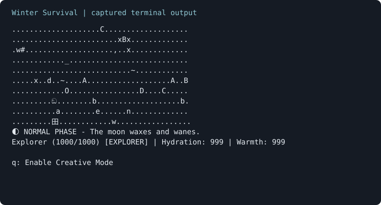

# Winter Survival

A terminal-based Java survival sandbox developed by a **team of four**. Explore two maps, forage growing trees, tame wildlife, craft elemental potions, and experiment with animal forms.

This portfolio incorporates our team's later game. **Esaam Matudin's contribution is identified below; the complete game and supplied engine are not solo work.**



## Gameplay and team features

- **Connected environments:** Forest and Plains, with teleport doors, circles, and a portable teleport cube.
- **Survival and companions:** health, hydration, warmth, consumables, weapons, taming, and priority-based animal behaviours.
- **Growing flora:** apple/yew trees change growth stages and produce fruit according to stage and map; hazelnut trees remain a separate resource.
- **Spawning ecosystem:** terrain-driven wildlife, crocodiles, poison, and post-spawn effects.
- **Creative mode:** toggle through the action menu to access potion brewing and Wolf, Bear, or Dragon player forms.
- **Lunar effects:** phases affect wolves and special berries. The HTTP adapter attempts to fetch a starting phase and falls back to NORMAL if unavailable. Successful live astronomy data is not required to play and was not verified for this update.

The team version starts with 1,000 health, hydration, and warmth. It is an experimental sandbox with no scripted victory condition. See [known limitations](docs/validation.md#known-limitations).

## My Contributions

**Esaam Matudin — flora implementation, design, testing, and integration.** Verified against authored commits and source:

- Implemented apple/yew tree growth and map-specific fruit-production rules for Forest and Plains.
- Introduced `TreeBehaviour.perform(Tree, Location)` and a `TreeMap<Integer, TreeBehaviour>` in abstract `Tree`. Growth and fruit-drop behaviours execute in ascending priority order on each tick.
- Added **35 JUnit/Mockito test methods** across `WildAppleTreeTest` and `YewBerryTreeTest`, covering initial stages, growth timing, map rules, and production intervals. This is a method count, not a coverage percentage or a claim that every assertion is strong.
- Authored the flora UML/design rationale, maintained Javadocs, and merged the flora branch into the shared codebase.

The interface separates ticking from individual operations. Map-name checks and stage branches remain in concrete behaviours, so new biomes require edits. [Design discussion](docs/design/flora.md) · [Evidence and teammate credits](ATTRIBUTION.md)

## Technology

Java 17 source target, Maven, JUnit Jupiter, Mockito, OkHttp, and org.json. The supplied engine provides the world loop, maps, actor/item abstractions, action menus, and inventory/attribute infrastructure.

## Build, test, and run

Install **JDK 17+** and **Maven 3.9+**. Use an interactive UTF-8 terminal; the player and some terrain use Unicode glyphs.

```bash
git clone https://github.com/sambalbalado/winter-survival-java.git
cd winter-survival-java
mvn clean verify
```

Prepare runtime libraries and launch:

```bash
mvn org.apache.maven.plugins:maven-dependency-plugin:3.7.1:copy-dependencies -DincludeScope=runtime
java -jar target/winter-survival-java-1.0.0.jar
```

Or use `./scripts/run.sh` to build, copy runtime libraries, and launch. Maven needs network access on the first run. Keep `target/dependency/` beside the JAR; it is not self-contained. In an IDE, import `pom.xml` and run `game.app.Application` with standard input connected.

### Controls

Enter the displayed key followed by Return. Movement uses 8 north, 2 south, 4 west, 6 east; 7/9/1/3 diagonally; 5 waits. Other actions receive dynamic letter keys. Use `>` and `<` for menu pages. Choose **Enable Creative Mode** to reveal morphing options; its key can change. Stop with Ctrl+C.

## Tests and validation

`mvn clean verify` runs **117 tests**: 109 imported team tests and eight adapted regression checks retained from the earlier portfolio. The two original flora test classes account for 35 methods. Sources are under `src/test/java/game/`. Unit tests use service test doubles rather than live HTTP calls.

See [validation notes](docs/validation.md) for local results, runtime checks, runtime dependency setup, and remaining issues.

## Structure and design

| Path | Responsibility |
| --- | --- |
| `game/flora`, `behaviours/TreeBehaviour.java` | Growth stages and ordered tree operations |
| `game/creatures`, `spawning`, `grounds` | Wildlife, terrain, spawning, crafting tables |
| `game/actions`, `items`, `potions`, `status` | Commands, inventory, effects, crafting |
| `game/characters`, `monsters`, `teleport`, `api`, `lunar` | Player forms, monsters, transport, lunar systems |
| `edu/monash/fit2099/engine` | Supplied engine; original notices preserved |
| `docs/design` | Original team UML and reviewed rationale summaries |

Paths above are relative to `src/main/java/` unless stated otherwise.

[Architecture](docs/architecture.md) · [Team systems](docs/design/team-systems.md) · [Interview guide](docs/interview-guide.md) · [Migration](docs/migration.md)

## Team and provenance

**Esaam Matudin, Sai Sann Thet Lone, Taiyo Arima, and Taabish Farooq Bhat.** Engine: **Riordan Alfredo and Adrian Kristanto**. See [ATTRIBUTION.md](ATTRIBUTION.md) for ownership, original source, AI-assistance acknowledgement, and distribution status.

The earlier individual version remains in Git history. Its documentation and gameplay image are retained, clearly labelled, in `docs/archive/` and `docs/images/individual-gameplay.png`.
