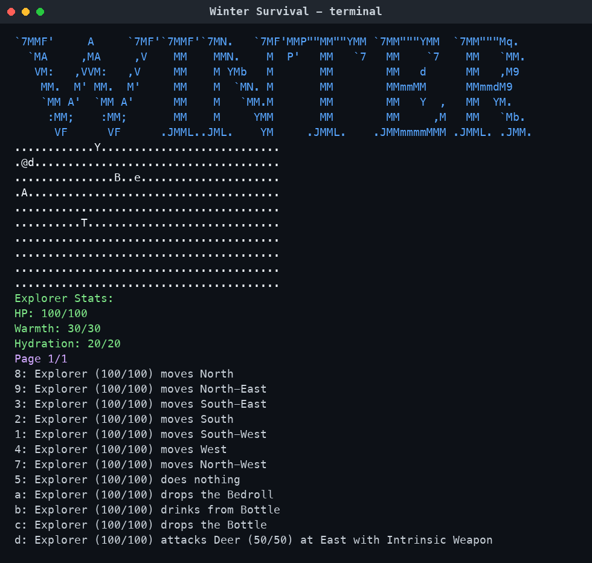
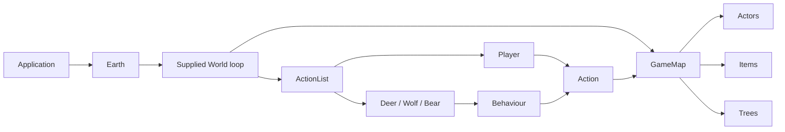

# Winter Survival

A terminal-based, turn-driven Java survival game in which an explorer manages warmth and hydration, forages renewable resources, fights wildlife, and tames animal companions.



## Overview

Winter Survival is an open-ended survival sandbox played on a 40-by-10 snow map. Every interactive player turn consumes one warmth and one hydration point. The player must use limited supplies, collect food produced by trees, avoid poisonous berries, and decide whether nearby wildlife should be fought or tamed.

The implementation is organised around small actions, capability interfaces, composable NPC behaviours, and engine extension points. The game-specific code builds on a supplied object-oriented console engine; the ownership boundary is documented in [ATTRIBUTION.md](ATTRIBUTION.md).

## Gameplay

The Explorer begins with 100 health, 30 warmth, 20 hydration, a five-use bottle, and a bedroll. The game continues until the Explorer is removed from the world after health, warmth, or hydration reaches zero. There is no scripted victory condition.

During a run, the player can:

- Move in eight directions and wait.
- Attack adjacent animals with an intrinsic weapon.
- Pick up, drop, eat, and drink items.
- Drop the bedroll and sleep for a randomly selected six to ten rounds.
- Tame a deer, wolf, or bear by offering one carried food item.
- Use tamed companions' specialised behaviour: following, protection, or food collection.

## Key features

- **Survival attributes:** health, warmth, and hydration determine whether the player remains conscious.
- **Turn-based action system:** the world builds a context-sensitive action list from movement, inventory, terrain, nearby actors, and ground items.
- **Wildlife AI:** animals select reusable behaviours from a priority-ordered map.
- **Companion system:** all three animals implement a shared `Tamable` contract; wolves and bears can defend their owner, while deer can gather and deliver food.
- **Renewable ecosystem:** apple, hazelnut, and yew trees create items on independent turn schedules.
- **Typed interactions:** `Eatable`, `Drinkable`, `Sleepable`, and `Tamable` decouple actions from concrete domain classes.
- **Automated verification:** JUnit tests cover consumables, hydration limits, taming state, and tree production intervals.

## Architecture

`Application` creates an `Earth` world, which configures one `GameMap` and its actors and terrain. The supplied `World` loop ticks the map, draws it, asks each actor to select an `Action`, executes that action, and records it for possible multi-turn continuation.



See [Architecture](docs/architecture.md) for the turn sequence, package responsibilities, and a focused UML class diagram.

## Object-oriented design

- **Abstraction:** engine abstractions such as `Actor`, `Action`, `Item`, `Ground`, and `World` define stable extension points for game types.
- **Inheritance:** concrete actors, actions, items, weapons, trees, and terrain reuse those engine contracts.
- **Interface-driven polymorphism:** actions depend on `Eatable`, `Drinkable`, `Sleepable`, or `Tamable`, so interaction logic is not tied to a single item or animal class.
- **Composition:** each animal owns a priority-ordered set of `Behaviour` objects instead of placing all AI decisions in the actor class.
- **Encapsulation:** actors control their attributes and inventory; callers receive unmodifiable views rather than direct mutable collections.

## Design patterns

| Pattern | Participants | Why it is useful |
| --- | --- | --- |
| Command | `Action`, `AttackAction`, `EatAction`, `DrinkAction`, `SleepAction`, `TameAction` | Represents player and NPC decisions as executable objects that can be listed, selected, and continued across turns. |
| Strategy | `Behaviour` with `AttackBehaviour`, `FollowBehaviour`, `ProtectOwnerBehaviour`, `CollectFoodBehaviour`, and `WanderBehaviour` | Lets animals combine reusable decision policies and change priorities without a single monolithic AI method. |
| Factory (supplied engine) | `GroundCreator`, `DefaultGroundCreator`, `Snow` supplier registration | Converts map symbols into terrain instances without hard-coding concrete ground construction into `GameMap`. |

The project does not claim formal State or Observer implementations; taming is represented by ordinary object state and ownership references.

## UML and architecture documentation

The project includes a deliberately scoped UML class diagram that models the four main gameplay areas: survival equipment, wildlife behaviours and combat, renewable food sources, and taming/companions. It demonstrates practical class-diagram skills including inheritance, interface realisation, composition, and dependency relationships without reproducing every engine class.

## Project structure

```text
winter-survival-java/
├── README.md
├── ATTRIBUTION.md
├── pom.xml
├── docs/
│   ├── architecture.md
│   ├── interview-guide.md
│   └── images/gameplay.png
└── src/
    ├── main/java/
    │   ├── game/                         # Game-specific implementation
    │   │   ├── actions/
    │   │   ├── actors/
    │   │   ├── behaviours/
    │   │   ├── capabilities/
    │   │   ├── items/
    │   │   ├── trees/
    │   │   └── weapons/
    │   └── edu/monash/fit2099/engine/    # Supplied engine; attribution preserved
    └── test/java/game/                   # JUnit gameplay tests
```

## Tech stack

- Java 17+
- Maven 3.9+
- JUnit Jupiter 5
- Mermaid for architecture and UML documentation

## Getting started

### Prerequisites

- JDK 17 or newer
- Maven 3.9 or newer

### Build and test

```bash
mvn clean test
```

### Run

```bash
mvn package
java -jar target/winter-survival-java-1.0.0.jar
```

These commands have been verified on OpenJDK 23 and Maven 3.9.11. The project compiles against Java 17.

## Controls

Movement uses numeric-keypad directions, entered as a number followed by Return:

```text
7 8 9    north-west  north  north-east
4 5 6    west        wait   east
1 2 3    south-west  south  south-east
```

Other available actions receive letter keys dynamically. The menu describes the exact action, such as drinking, attacking, picking up an item, dropping equipment, sleeping, eating, or taming an animal.

## Engineering highlights

- Modelled four gameplay areas with focused UML class diagrams and translated those relationships into Java abstractions.
- Extended a reusable engine through inheritance and interfaces while keeping gameplay rules in the `game` package.
- Used dependency inversion in interaction actions: for example, `EatAction` depends on `Eatable`, while `TameAction` and companion behaviours depend on `Tamable`.
- Composed NPC decision-making from small behaviour objects with deterministic priority ordering.
- Added a repeatable Maven build and eight automated tests around the highest-value domain rules.
- Preserved third-party/supplied authorship instead of presenting engine code as original work.

## Current limitations and future improvements

- Add an explicit objective, score, or turn-based survival milestone; the current loop is intentionally open-ended.
- Add a warming interaction so warmth management has an active recovery path beyond chained sleep pausing player resource decay.
- Extract repeated taming state and behaviour-selection code shared by `Bear`, `Wolf`, and `Deer` without forcing unrelated animals into an inflexible hierarchy.
- Replace greedy Manhattan movement with obstacle-aware pathfinding on more complex maps.
- Inject random-number sources and timing so combat and sleep are fully deterministic in tests.
- Add end-to-end tests for interactive menu flows.

## Author

**Esaam Matudin**

For interview-ready explanations of the implementation, see [Project interview guide](docs/interview-guide.md).
