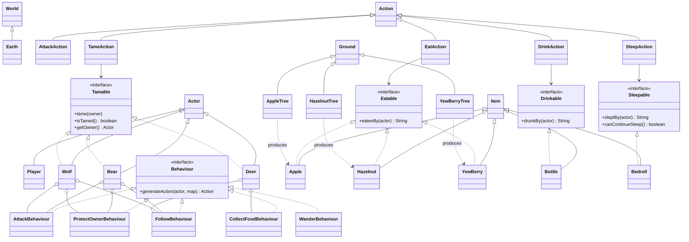

# Architecture

## System boundary

Winter Survival is split into two layers:

1. `game` contains the survival domain and its concrete gameplay rules.
2. `edu.monash.fit2099.engine` contains the supplied console engine. It owns the generic world loop, map, menu, entity base types, inventory mechanics, and movement plumbing.

The game layer depends on the engine layer. The engine has no dependency on the concrete winter-survival classes.

## Turn sequence

```mermaid
sequenceDiagram
    participant App as Application
    participant World as World
    participant Map as GameMap
    participant Actor as Current Actor
    participant Action as Selected Action

    App->>World: constructWorld() and run()
    loop while the player remains in the world
        World->>Map: tick()
        Map->>Map: tick actors, items, ground, and statuses
        World->>Map: draw(display)
        loop each actor, player first
            World->>World: prepareAllowableActions(actor, location)
            World->>Actor: playTurn(actions, lastAction, map, display)
            Actor-->>World: Action
            World->>Action: execute(actor, map)
            Action-->>World: result message
        end
    end
```

The `lastAction` reference enables multi-turn commands. `SleepAction.getNextAction()` returns itself while the bedroll has rounds remaining, so the player continues sleeping without reopening the menu.

## Focused UML class diagram

This diagram intentionally omits most supplied engine internals and concentrates on the four game-specific areas: survival equipment, wildlife/combat behaviours, resource-producing trees, and taming.



## Package responsibilities

| Package | Responsibility |
| --- | --- |
| `game` | Application entry point, world construction, survival attributes, and terrain registration. |
| `game.actions` | Executable combat, consumption, sleep, and taming commands. |
| `game.actors` | Player and animal state, inventory setup, intrinsic weapons, and behaviour selection. |
| `game.behaviours` | Reusable animal decision policies that return actions or decline with `null`. |
| `game.capabilities` | Narrow interaction contracts used by actions and domain objects. |
| `game.items` | Consumables and survival equipment. |
| `game.trees` | Timed ground types that place resources on adjacent tiles. |
| `game.weapons` | Concrete intrinsic weapon configurations. |
| `edu.monash.fit2099.engine` | Supplied reusable framework: world loop, maps, locations, base entities, menus, and core actions. |

## Behaviour priority

Animals store behaviours in a `TreeMap<Integer, Behaviour>`, so lower numeric keys run first. The first behaviour that produces a non-null action wins.

| Animal state | Priority order |
| --- | --- |
| Wild bear or wolf | attack adjacent actor, then wander |
| Tamed bear or wolf | protect from adjacent predators, follow owner, then wander |
| Wild deer | wander |
| Tamed deer | collect/deliver food, follow owner, then wander |

## State representation

- Generic actor attributes are stored by enum key in the engine's `Map<Enum<?>, ActorAttribute<Integer>>`.
- The player adds `HYDRATION` and `WARMTH` alongside engine-provided health.
- Abilities such as `CAN_ATTACK`, `PREDATOR`, and `FOOD` are enum values attached to entities.
- Taming is explicit boolean state plus an owner reference in each tamable animal.
- World occupancy is a bidirectional actor/location mapping that enforces one actor per tile.

## Extension points

A new consumable can extend `Item`, implement `Eatable`, and expose `EatAction` without changing the action itself. A new animal role can implement `Behaviour` and be inserted at an appropriate priority. A new tree can extend `Ground`, use `tick`, and place its resource into neighbouring locations. These are practical Open/Closed Principle examples, although the duplicated taming fields in the three animals remain a known trade-off.
