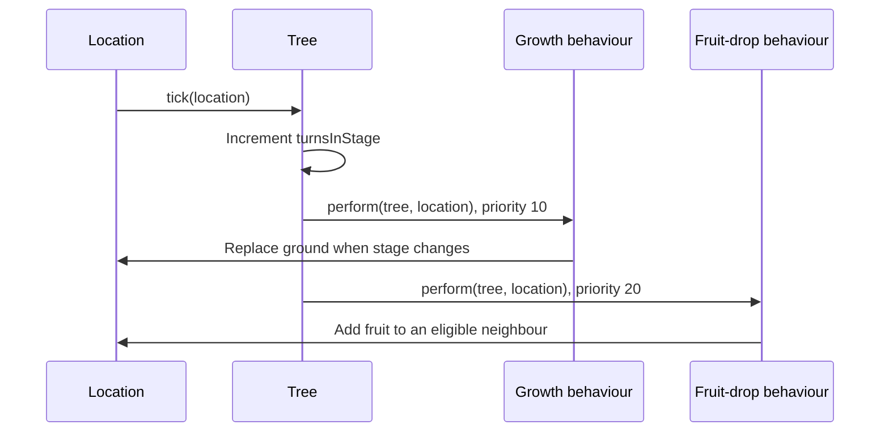

# Architecture

`game.app.Application` creates `Earth`, which configures Forest/Plains maps, actors, resources, teleport fixtures, and a lunar manager. The supplied `World` drives map ticks, menu selection, and action execution.

| Layer | Extension points |
| --- | --- |
| Supplied engine | Actor, Action, Item, Ground, GameMap, World, Display |
| Gameplay | Player/animals, commands, consumables, statuses, flora, terrain, transport |
| External service | MoonPhaseService, OpenMeteoService, LunarPhaseManager |
| Verification | JUnit/Mockito test doubles and retained real-map regression checks |

## Tree tick sequence

`Tree` owns a sorted map of `TreeBehaviour` operations. Lower numeric priorities execute first. `Stage` names SPROUT, SAPLING, and TREE. Growth replaces the ground with a new tree and transfers the fruit counter; the instance does **not** persist through every transition, despite that claim in the original rationale.

Animal behaviour selection and tree execution differ: animals generally choose an action, while trees run all operations per tick. Actions represent commands integrated with the engine. The tree interface is useful, but concrete rules remain coupled to stage branches and map-name strings.

[Flora decisions](design/flora.md) · [Team systems](design/team-systems.md) · [Limitations](validation.md) · [Earlier architecture](archive/architecture.md)
