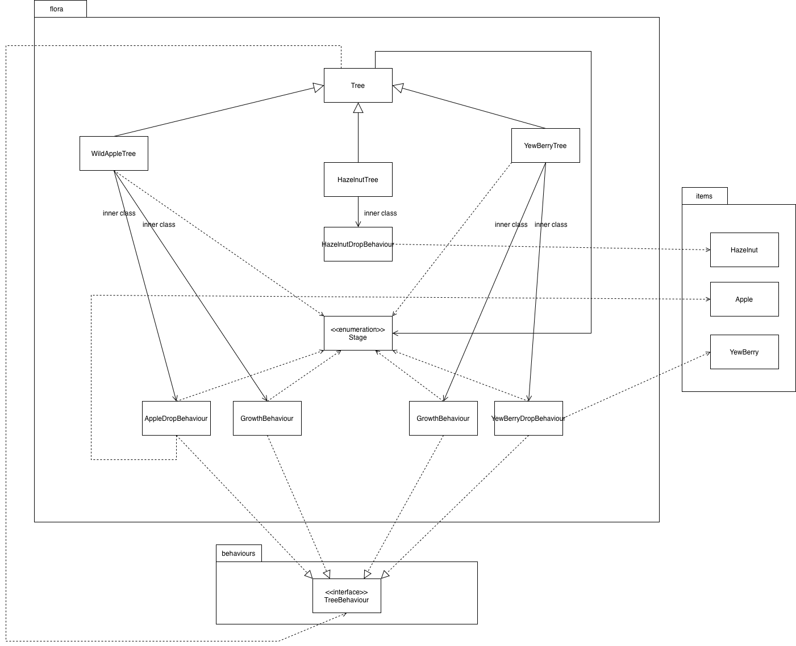

# Flora: decisions and tradeoffs

Implementation/original UML and rationale: **Esaam Matudin**, extending flora base work credited to **Taabish Farooq Bhat**.

## Actual implementation

- `Tree extends Ground`: location ticks trigger growth/production without engine changes.
- `Stage` restricts lifecycle states. Wild apples start as SPROUT; yew trees as SAPLING.
- `TreeBehaviour.perform(Tree, Location)` is the shared operation. A `TreeMap` executes growth at priority 10 before production at 20.
- Forest apples pass through three stages; Plains apples skip SAPLING. Production intervals also depend on stage/environment.
- Growth replaces ground instances and copies the fruit counter, contrary to the original rationale's persistent-instance description.

## Decision and tradeoff

The common tick mechanism invokes operations through an interface instead of embedding every operation in `Tree.tick`. Priority establishes ordering. However, inner behaviours still depend on the concrete tree's counters, randomness, stage, and map names. New biome rules require branch edits. Policy/configuration objects could improve this later; this integration preserves the team's design.

## Tests and review

`WildAppleTreeTest` contains 16 methods and `YewBerryTreeTest` 19. Mockito maps/locations isolate initial stages, growth thresholds, and fruit intervals. Some assertions are permissive, and random growth lacks injection. Passing the suite is not exhaustive verification. The earlier portfolio's mature-tree checks use real maps as extra regressions.

The original feedback flagged hardcoded branching, magic values, inner-class organisation, documentation/UML gaps, and limited extensibility. The portfolio describes implemented mechanisms without claiming complete SOLID compliance. Hazelnuts remain available but are not presented as the assessed apple/yew requirement.
